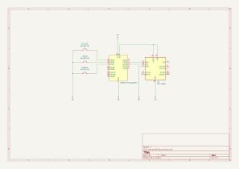
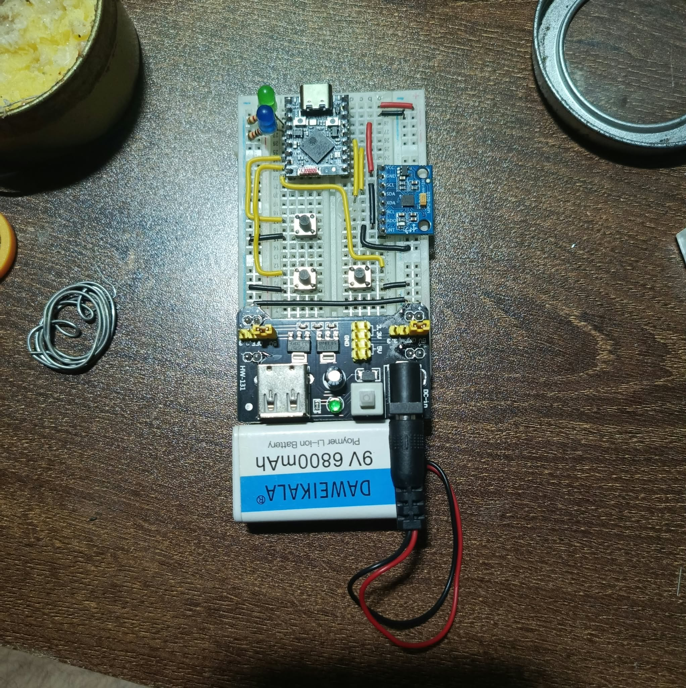

# ESP32-C3 Wireless BLE Air Mouse

An inertial Bluetooth Low Energy (BLE) air mouse built with the ESP32-C3 Super Mini microcontroller and an MPU-6050 6-axis IMU. It emulates a standard BLE HID mouse compatible with Windows, Linux, macOS, Android, and iOS.

---

## Features

- **Inertial Air Tracking**: Uses pitch (vertical) and yaw (horizontal) angular velocity from the gyroscope.
- **Drift & Tremor Suppression**: Exponential moving average (EMA) low-pass filter with deadzone filtering.
- **Scroll Wheel Mode**: Hold the dedicated scroll button (Pin 10) and tilt up/down to scroll.
- **Left Click & Drag**: Debounced press and release support on Pin 20.
- **Right Click**: Debounced press and release support on Pin 21 (context menus & hold support).
- **Dual LED Status Indicators**:
  - **Calibrated Indicator (Pin 5)**: External LED stays permanently ON once zero-offset calibration completes.
  - **Button Activity (Pin 6)**: External LED lights up whenever any button is actively pressed.
  - **Onboard User LED (Pin 8)**: Active-LOW blue LED lights up during calibration and mirrors button clicks.
- **Smart Power Management**: Sensor is kept in hardware sleep while disconnected; automatically wakes and calibrates only upon active BLE connection.
- **Auto-Reconnecting & Advertising**: Seamless host switching with automatic BLE advertising restart upon disconnect.
- **Serial Debugging**: 115200 baud output for clicks, scrolling events, calibration offsets, and BLE MAC address readout.

## Schematic Diagram



### Breadboard Prototype



---

## Hardware Pinout (ESP32-C3 Super Mini)

| Component | Pin / GPIO | Description |
| :--- | :--- | :--- |
| **MPU-6050 SDA** | `GPIO 3` | I2C Data |
| **MPU-6050 SCL** | `GPIO 2` | I2C Clock |
| **MPU-6050 VDD / VLOGIC** | `3V3` | 3.3V Power & Logic rail |
| **MPU-6050 GND & AD0** | `GND` | Common Ground (AD0 pulls address to `0x68`) |
| **Left Button (LeftSW)** | `GPIO 20` | Push button to `GND` (Internal Pull-up) |
| **Right Button (RightSW)** | `GPIO 21` | Push button to `GND` (Internal Pull-up) |
| **Scroll Button (ScrollSW)** | `GPIO 10` | Push button to `GND` (Internal Pull-up) |
| **Calibrated LED (Green)** | `GPIO 5` | External LED (via 220Ω–470Ω resistor to `GND`); permanently ON when ready |
| **Button Click LED** | `GPIO 6` | External LED (via 220Ω–470Ω resistor to `GND`); ON during button presses |
| **Onboard User LED** | `GPIO 8` | Onboard blue LED (Active-LOW) |

> **Note**: Buttons are wired between the designated GPIO pin and **GND** (internal pull-ups enabled). External LEDs **require** a 220Ω–470Ω series resistor to avoid damaging the GPIO pins.

---

## Required Libraries

Install the following libraries via the Arduino IDE Library Manager or `arduino-cli`:

1. **ESP32-BLE-Mouse** (by T-Party / wakwak-koba):
   - Library: `ESP32-BLE-Mouse`
2. **NimBLE-Arduino** (by h2zero):
   - Library: `NimBLE-Arduino` (Required for `#define USE_NIMBLE` to minimize RAM and flash footprint)
3. **Wire** (Standard Arduino I2C library, built into ESP32 core)

---

## Build & Upload Instructions

### Option A: Using Arduino IDE (Windows & Linux)

1. **Install ESP32 Board Support**:
   - Open **File > Preferences**.
   - In *Additional Boards Manager URLs*, add:
     ```text
     https://raw.githubusercontent.com/espressif/arduino-esp32/gh-pages/package_esp32_index.json
     ```
   - Open **Tools > Board > Boards Manager...**, search for `esp32`, and install **esp32 by Espressif Systems**.

2. **Select Board and Configuration**:
   - Board: **ESP32C3 Dev Module** (or your specific C3 Super Mini board).
   - USB CDC On Boot: **Enabled** (Important for Serial output over USB-C).
   - Flash Size: **4MB**.
   - Partition Scheme: **Default 4MB with spiffs** (or *Minimal SPIFFS*).

3. **Install Libraries**:
   - Go to **Sketch > Include Library > Manage Libraries...**.
   - Search and install `NimBLE-Arduino`.
   - Search and install `ESP32 BLE Mouse`.

4. **Flash the Sketch**:
   - Connect the ESP32-C3 via USB.
   - Select the COM port (`COMx` on Windows, `/dev/ttyACM0` or `/dev/ttyUSB0` on Linux).
   - Click **Upload**.

---

### Option B: Using Command Line / arduino-cli

#### Linux

1. **Dialout Permissions**:
   Ensure your user has access to serial ports:
   ```bash
   sudo usermod -aG dialout $USER
   # Log out and log back in for changes to take effect
   ```

2. **Install Board Core and Libraries**:
   ```bash
   arduino-cli core update-index --additional-urls https://raw.githubusercontent.com/espressif/arduino-esp32/gh-pages/package_esp32_index.json
   arduino-cli core install esp32:esp32 --additional-urls https://raw.githubusercontent.com/espressif/arduino-esp32/gh-pages/package_esp32_index.json
   arduino-cli lib install "NimBLE-Arduino"
   arduino-cli lib install "ESP32 BLE Mouse"
   ```

3. **Compile, Upload & Monitor in One Shot**:
   ```bash
   arduino-cli compile --fqbn esp32:esp32:esp32c3:CDCOnBoot=cdc -u -t -p /dev/ttyACM0 -c baudrate=115200 .
   ```

#### Windows

1. **Install via PowerShell**:
   ```powershell
   arduino-cli core update-index --additional-urls https://raw.githubusercontent.com/espressif/arduino-esp32/gh-pages/package_esp32_index.json
   arduino-cli core install esp32:esp32 --additional-urls https://raw.githubusercontent.com/espressif/arduino-esp32/gh-pages/package_esp32_index.json
   arduino-cli lib install "NimBLE-Arduino"
   arduino-cli lib install "ESP32 BLE Mouse"
   ```

2. **Compile, Upload & Monitor in One Shot**:
   ```powershell
   arduino-cli compile --fqbn esp32:esp32:esp32c3:CDCOnBoot=cdc -u -t -p COM3 -c baudrate=115200 .
   ```

---

## Operating Instructions

### 1. Connection-Triggered Calibration & Sleep
- Upon boot, the sensor remains in **hardware sleep mode** and indicator LEDs stay OFF while advertising.
- When your host device (PC/phone) connects, the sensor automatically wakes and begins calibration:
  - **Onboard User LED (GPIO 8) turns ON**: keep the mouse stationary on a flat surface (~1.5s).
  - When calibration finishes, the **Onboard User LED turns OFF** and the **External Calibrated LED (GPIO 5) turns permanently ON**.
- If the host disconnects, the mouse turns off indicators, puts the sensor back to sleep, and resumes advertising for the next device.

### 2. Pairing with Your Computer

#### Windows 10 / 11
1. Open **Settings > Bluetooth & devices**.
2. Turn Bluetooth **On** and click **Add device**.
3. Select **Bluetooth**.
4. Click on **ESP32-C3 Air Mouse**.
5. Once paired, the mouse is ready to use immediately.

#### Linux (GNOME / KDE / bluez)
- **GUI**: Open **Settings > Bluetooth**, wait for **ESP32-C3 Air Mouse** to appear, and click **Connect**.
- **CLI (`bluetoothctl`)**:
  ```bash
  bluetoothctl
  scan on
  # Look for "ESP32-C3 Air Mouse" and copy its MAC address (printed on Serial during startup)
  pair XX:XX:XX:XX:XX:XX
  trust XX:XX:XX:XX:XX:XX
  connect XX:XX:XX:XX:XX:XX
  ```

#### Android / iOS
1. Ensure the mouse is **disconnected from any other host** (e.g. disconnect or turn off Bluetooth on your PC).
2. On Android, make sure **Location** is turned ON (required for BLE discovery).
3. Open **Settings > Bluetooth / Connected Devices > Pair new device**.
4. Select **ESP32-C3 Air Mouse** from the list.
5. An on-screen mouse pointer will appear immediately once connected.

> **Host Switching Note**: The air mouse connects to one host at a time. When connected, advertising stops. To pair with a new device, disconnect from the current host—the mouse will automatically restart advertising.

---

## Controls & Usage

- **Cursor Tracking**: Point and tilt the controller. Pitch controls vertical movement; yaw controls horizontal movement.
- **Left Click**: Press button on `GPIO 20`. Can be held down for drag-and-drop operations.
- **Right Click**: Press button on `GPIO 21`. Supports standard clicks and right-click holds/context menus.
- **Scroll Wheel**: Press and hold the scroll button on `GPIO 10`, then tilt the controller up or down to scroll. Cursor tracking is temporarily locked while scrolling.
